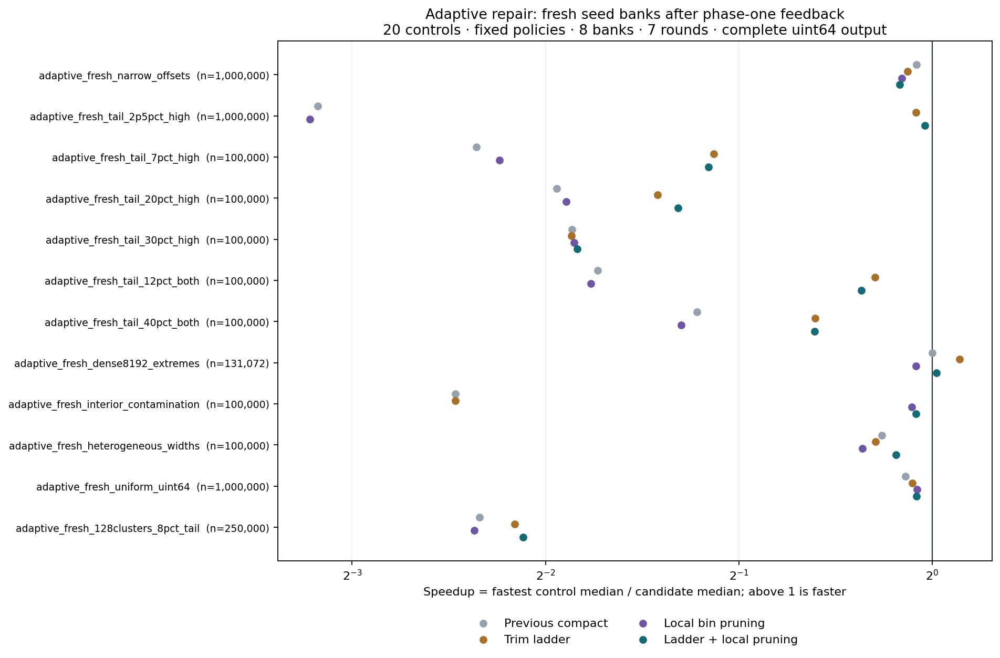

# BRC 残差排序：逐级修剪与局部分组放弃的第二轮实验

日期：2026-11-10。研究记录：`EM-DIRECT-10677F / TASK_RESEARCH`；活动：`RA-851F29EFE6B4190069FE0D3B`。

## 结论

**本轮修复了上一版的若干严重退化，但没有证明通用排序优势，也没有获得新的渐近复杂度突破。** 在冻结后的 12 个新种子条件中，组合版有 11 个比上一版连续区间方案快，速度比的几何平均为 1.746；但对每个条件下同场最快的 20 个既有对照，只有 1 个中位数略快，没有一个达到 1.10 倍，几何平均速度比为 0.633。校准集上的较好表现没有完整延续到新的困难输入。

最明显的修复发生在一百万个数、2.5% 高端远离主体的异常值条件：上一版需 45.648 毫秒，组合版降到 5.180 毫秒，同场最快的 `flat_frequency` 为 5.047 毫秒。相对自身上一版快 8.812 倍，仍稍慢于最快既有对照。这两种比较回答不同问题，不能互相替代。

完整输出为按数值非递减排列的 `uint64_t` 数组，保留所有重复出现次数。本实验沿用项目中“残差归类后完整排序”的具体实现；不把一个未另行定义的 BRC 标签顺序当作数值排序已经完成。

## 1. 与第一轮的关系

第一轮研究完整样本被少数远端值撑宽，以及局部计数表过碎的问题，增加了全范围探测、单档修剪、两者组合和连续区间四个版本，并加入固定版本的上游 `pdqsort`。该轮已经单独冻结、测量和提交：

- [第一轮完整报告](https://github.com/awdawmip/enterprise-math/blob/085ff2fb544cd2bfc85beb75cfd72ed15f6a0569/experiments/brc_residual_sort_robust_20261110_b0e94005/README.md)
- 第一轮科学提交：`085ff2fb544cd2bfc85beb75cfd72ed15f6a0569`。

连续区间版在第一轮 14 个新种子条件中，相对当时最强的 16 个既有对照有 6 个中位数胜出，5 个至少达到 1.10 倍；同时也有 5 个至少慢 10%，几何平均速度比为 0.859。局部胜例包括：

| 第一轮新条件 | n | 连续区间版，µs | 最快既有对照，µs | 对照耗时 / 新版耗时 |
|---|---:|---:|---:|---:|
| 0.01% 高端远端值 | 100,000 | 233.546 | 587.259 | 2.515 |
| 1% 高端远端值 | 100,000 | 319.815 | 558.025 | 1.745 |
| 4,096 宽稠密区间加两个极端值 | 100,000 | 436.354 | 987.685 | 2.263 |
| 8,192 宽稠密区间加 0.3% 极端值 | 131,072 | 859.924 | 1991.239 | 2.316 |

相反，2% 高端异常和分组内部污染会让第一轮连续区间版明显退化。本轮是在看过这些失败以后设计的新修复实验，因此相关旧样本明确列为校准，不能继续称作未见数据。

两轮正式最终运行合计 1,712 条“条件 × 算法”的汇总行：第一轮 58 × 20 = 1,160，第二轮 24 × 23 = 552。58 + 24 是条件评价次数，第二轮有 8 个复用的校准条件，并非 82 个独立分布或独立数据集。

## 2. 新算法及固定参数

本轮增加三个版本：

| 实现名 | 样本修剪 | 局部分组放弃 |
|---|---|---|
| `adaptive_trim_1024` | 三档 | 无 |
| `adaptive_prune_1024` | 第一档 | 有 |
| `adaptive_combined_1024` | 三档 | 每档在预算失败后尝试 |

每个递归节点继承以下规则：样本量 `S=min(n,1024)`；`n<=256` 使用 `std::sort`；深度到 16 使用偏移基数排序；计数表预算为 `min(4*1024*1024, max(4096,n/2))` 个计数槽。区间和跨度计算使用 128 位中间值，输入仍是 64 位无符号整数。

先检查原始样本的连续区间是否可用，再检查原始稀疏网格。只有原模型超出计数预算，才进入下面的模型迭代：

1. 从**完整原始样本**分别取两端修剪秩 `S/64`、`S/16`、`S/4`，不在上一次修剪后的样本上继续累计修剪。边界相等值全部保留。
2. 每档先考虑连续区间，再考虑局部分组计数表。
3. 若允许局部分组放弃且计数槽过多，将正宽度分组按填充后的宽度从大到小排列，同宽按原分组编号。依次放弃最宽分组，直到剩余计数槽不超过预算。
4. 只有剩余学习观测数仍至少是**原始 S 的一半**，才接受这个分组方案。失败的提议不修改原模型。
5. 第一个通过模型检查的方案接受一次实际输入扫描。若实际残差数超过 `floor(n/2)`，立即停止前缀扫描并对仍完整保留的原数组使用偏移基数排序；不会重新尝试更高档模型。
6. 实际残差不超过一半时，只递归排序残差，将精确计数部分展开，再与残差结果合并。

因此，这里有两种不同的“迭代”：一种是只在小样本上调整模型，另一种是在全部实际残差上递归。前者的样本覆盖率不能代替后者的真实收缩条件。

**修剪样本不删除输入值；放弃分组仅取消其计数表资格。** 所有落在这些区域的实际输入出现次数都会进入残差数组，或随整份原数组进入正确的回退排序。

简化流程为：

```text
sort(A):
    if A is small: ordinary_sort(A)
    if recursion limit reached: offset_radix(A)
    model = first_budget_feasible_model(sample(A))
    if no model: offset_radix(A)
    scan A into exact histogram H and residual occurrences E
    if |E| exceeds floor(|A|/2): offset_radix(original A)
    else:
        sort(E)
        emit H in increasing order
        merge emitted values with E
```

精确顺序、填充规则、样本观测计数、拒绝路径及诊断字段以 [adaptive_kernels.hpp](adaptive_kernels.hpp) 为准。证明、正例构造和反例见 [THEORY.md](THEORY.md)。

## 3. 冻结与测试设计

实现于 `2026-11-10T02:31:43.808524+00:00` 冻结，见 [frozen_implementation.json](frozen_implementation.json)。冻结在 8 个已知校准条件测量之后、12 个新种子条件生成与测量之前；校准后没有参数或算法修改。第一轮代码保持原样，由适配器生成临时包含文件来替换命名冲突。

第二轮包含 24 个条件：8 个旧条件校准、12 个新种子条件、4 个确定性机制条件。三个新条件扩大到一百万个数：窄范围偏移、2.5% 高端异常、全 64 位均匀数。其他新条件包括 7%/20%/30% 高端异常、12%/40% 双端异常、稠密主体加极端值、内部污染、不同组宽和 128 簇加 8% 尾部。

“新种子”只表示冻结前未执行这些输入库；分布家族及更困难参数根据第一轮结果定向选择。它们不是业务负载的无偏随机样本，也不意味着所有分布概念都未见过。

共有 23 个候选：新版本 3 个，冻结对照 20 个。对照包括 `std_sort`、上游 `pdqsort`、`offset_radix`、`range_count_or_radix`、两种频数排序、此前的残差/仿射/局部/样本实现及第一轮四个版本。完整名称在 [analysis_summary.json](analysis_summary.json)。

每个条件 8 个输入库；每个算法 7 轮，算法顺序随机；每轮名义目标 12 毫秒，以完整输入库循环计数，单次慢排序可能超过目标。报告七轮的中位数。正式计时包含输入复制、样本学习、模型建立、内存分配、完整排序输出、归并和析构，不把准备工作预先免费完成。诊断另跑，计时的空诊断指针路径不分配轨迹向量。

硬件为 Intel Xeon Platinum 8573C，Linux 6.18.57 x86_64，glibc 2.39，GCC 13.3.0，C++20，`-O3 -DNDEBUG -march=native -Wall -Wextra`。正式计时固定 CPU 0，串行进行，团队没有同时运行其他基准或编译。共享云主机仍有频率及宿主噪声限制。

每个条件的比较基准是同一次运行中 20 个对照的最快中位数。这是逐条件最强参考，不是一个已经实现的自动选择器。比值定义为 `最快对照耗时 / 候选耗时`；大于 1 才是候选更快。10% 阈值只是一项描述性幅度，不是显著性检验。CSV 的 p10/p90 是七轮内的经验分位数，不是置信区间。

## 4. 最终新输入结果

以下为第二轮正式最终运行，单位为微秒。完整 24 条条件表在 [analysis_table.md](analysis_table.md)，所有 552 条算法汇总及七轮数据在 [results_all.csv](results_all.csv)。

| 新条件 | n | 上一版连续区间 | 本轮组合版 | 最快既有对照 | 对照耗时 | 对照/组合 |
|---|---:|---:|---:|---|---:|---:|
| 窄范围偏移 | 1,000,000 | 3056.397 | 3248.876 | sampled_recursive_1024 | 2891.949 | 0.890 |
| 2.5% 高端异常 | 1,000,000 | 45648.434 | 5180.375 | flat_frequency | 5046.624 | 0.974 |
| 7% 高端异常 | 100,000 | 4241.645 | 1843.057 | flat_frequency | 827.102 | 0.449 |
| 20% 高端异常 | 100,000 | 3910.766 | 2529.555 | flat_frequency | 1018.050 | 0.402 |
| 30% 高端异常 | 100,000 | 3828.820 | 3752.694 | flat_frequency | 1052.246 | 0.280 |
| 12% 双端异常 | 100,000 | 3719.049 | 1442.574 | pdqsort | 1120.242 | 0.777 |
| 40% 双端异常 | 100,000 | 3913.158 | 2564.408 | flat_frequency | 1682.738 | 0.656 |
| 稠密 8,192 区间加极端值 | 131,072 | 802.974 | 790.870 | robust_compact_1024 | 802.974 | 1.015 |
| 内部分组污染 | 100,000 | 2049.262 | 392.785 | flat_frequency | 370.580 | 0.943 |
| 不同分组宽度 | 100,000 | 748.824 | 711.413 | range_count_or_radix | 625.427 | 0.879 |
| 全 64 位均匀数 | 1,000,000 | 36532.820 | 35126.212 | pdqsort | 33232.012 | 0.946 |
| 128 簇加 8% 尾部 | 250,000 | 6931.518 | 5924.414 | frequency_sort | 1368.109 | 0.231 |

汇总不挑选每个条件中最好的新变体，而是分别评估固定候选：

| 固定候选，12 个新条件 | 对最强 20 对照胜出数 | 至少 1.10 倍数 | 至少慢 10% 数 | 对照/候选的几何平均 | 相对上一版的几何平均 |
|---|---:|---:|---:|---:|---:|
| 逐级修剪 | 1 | 1 | 8 | 0.548 | 1.513 |
| 局部分组放弃 | 0 | 0 | 9 | 0.411 | 1.133 |
| 两者组合 | 1 | 0 | 8 | 0.633 | 1.746 |

组合版相对上一版在 11/12 条件胜出，其中 7 个达到 1.10 倍，但相对最强既有对照的唯一胜出只有约 1.5%。在未另行重复独立进程和硬件的情况下，不能把这种小差异视为稳定领先。



## 5. 已知失败样本的修复

以下使用同一正式最终运行中的校准行，不混用开发时先前测量：

| 已知条件 | 上一版，µs | 组合版，µs | 最快对照，µs | 对照/组合 |
|---|---:|---:|---:|---:|
| 2% 高端异常，100,000 个数 | 3886.634 | 518.821 | 633.567 | 1.221 |
| 5% 双端异常，100,000 个数 | 3871.401 | 718.371 | 853.770 | 1.188 |
| 内部污染，100,000 个数 | 2014.663 | 358.195 | 352.926 | 0.985 |

组合版在 8 个校准条件中的对照速度比几何平均为 1.054，3 个达到 1.10 倍；对新条件则降为 0.633。这表明修复机制确有作用，也表明不能根据校准成功就推断广泛优势。

## 6. 为什么仍然会慢：实际工作量

模型上的异常比例不是实际残差比例。两端按秩修剪会把一部分正常主体也移到残差中，且归并量取决于残差所在位置，不只取决于残差数量。以下均为八个输入库的诊断平均，不是耗时推算。

| 条件，组合版 | 根节点实际残差 | 全部节点输入总量 | 全部归并写入数 | 根节点选择 |
|---|---:|---:|---:|---|
| 一百万、2.5% 高端异常 | 67,480.75 | 1,067,480.75 | 878,125 | 全部选择每端秩 64 |
| 十万、7% 高端异常 | 43,591.625 | 160,999.875 | 143,591.625 | 全部选择每端秩 256 |
| 二十五万、128 簇加 8% 尾部 | 122,731.375 | 377,327.375 | 263,613.625 | 每端秩 256；根节点 2/8 扫描拒绝 |

第二行说明：输入只有 7% 的目标异常，当前对称修剪策略却留下约 43.6% 实际残差。它仍满足“不超过一半”的正确性和递归工作量条件，但这远不足以保证快过频数排序。第三行根节点拒绝时的残差统计是停止位置上的前缀数，不应解读为对全数组扫描后的总数。

百万 2.5% 条件从 45.648 降到 5.180 毫秒是显著的机制修复；仍有约 87.8 万次归并写入，说明计算少量样本或减少计数槽并没有消除输出工作。

源数据包括 [节点轨迹](results_all.csv.adaptive_nodes.csv) 和 [各次模型提议](results_all.csv.adaptive_attempts.csv)。诊断区分方案选中、样本质量门槛通过和实际残差门槛通过；被拒绝的尝试仍计入工作量。

## 7. 正确性、理论进展和边界

### 多重集合不变量

成功扫描的每一层都把实际输入的每个出现次数恰好分配给精确计数或残差，两者无遗漏、无重复。计数展开是有序的，递归结果是有序的，归并保持所有出现次数。如果前缀扫描提前拒绝，原数组没有被破坏，回退处理的是完整原输入。

### 实际残差减半

只在 `|E|<=floor(n/2)` 时递归，因此递归节点大小总和小于 `2n`。这仅是节点输入总量界；不能把它写成总共不到 `2n` 次操作。学习、扫描、计数初始化、展开、归并和回退仍各有成本。

在固定 64 位字长、固定样本/分组上限、计数预算和固定基数遍数的模型下，这个实现的时间与辅助空间均为 `O(n)`。标准整数基数排序在同样字长模型下已可做到线性时间，因此这不是越过现有整数排序复杂度的发现。完整读取任意输入并显式输出 n 个数仍有最坏情形 `Ω(n)` 的工作要求。这里不推广到无限精度自然数。

计数排序和基数排序的公开复杂度背景可核对 [Pat Morin, Open Data Structures, §11.2](https://opendatastructures.org/ods-cpp/11_2_Counting_Sort_Radix_So.html)。上游比较排序控制来自 [orlp/pdqsort](https://github.com/orlp/pdqsort)，不是使用其公开宣传数字替代本机实测。

### 局部分组放弃能修什么

THEORY.md 给出 20 簇、四个内部分组受污染的精确构造。在十万个数的机制条件，当前样本形成 71,034 个候选计数槽，预算 50,000；放弃最宽两个分组后留下 35,644 个槽和 900/1024 个原始样本观测，并能直接界定实际残差少于一半。它证明全局尾部修剪难处理的内部分组污染可以被局部规则修复。

但若只保留那些样本位置，再把未采样位置大量改到被放弃的分组，样本仍可通过，实际扫描会在第 50,001 个残差时拒绝。这是实际人口检查不可省略的构造反例。该机制条件下组合版约 1,888.618 µs，`pdqsort` 为 134.385 µs；正确回退不等于回退没有成本。

### 最宽优先并非样本质量最优

忽略样本质量约束时，最宽优先能以最少放弃分组数降低足够多的计数槽；加上保留至少半数样本的约束，这个贪心并不完备。一个抽象选择反例：三组宽度为 `(60000,40000,20000)`，学习观测为 `(900,60,64)`，预算 60000。贪心先去掉最大组，只剩 124 个观测，因不足 512 被拒绝；去掉后两个组却能保留 900 个观测和 60000 个槽。它是选择策略层面的反例，不是声称该三组配置已经在此基准生成器中出现。

这给下一项研究一个更具体的问题：在预算、覆盖量和预计残差归并成本之间做选择，而不只是再增加修剪档数。当前数据不支持把更多修复规则直接视为通用加速。

## 8. 验证证据

第二轮优化构建和 AddressSanitizer + UndefinedBehaviorSanitizer 构建各完成 732 个输入数组、4,392 次新算法输出校验：341 个穷举短数组、340 个数值提升数组、32 个随机边界数组和 19 个定向条件；覆盖 15 条执行路径，检查有诊断与空诊断两条路径。

定向验证包括精确秩及边界相等值、独立分组放弃顺序判据、实际前缀归属判据、样本质量拒绝、空提议、实际减半、子层分组放弃、强制深度回退。新种子性能输入没有在冻结前的 `--verify` 中生成。

正式性能运行对 192 个输入库的全部 23 个算法，在两条诊断路径上完成 8,832 次输出比较；期望结果为 `std::sort` 的完整数组，验证包含重复次数。共产生 552 条性能行、2,274 条节点轨迹和 1,372 条模型尝试轨迹，正式运行耗时约 402.579 秒。

第一轮另有各构建 2,824 个验证输入和 28,238 次输出校验，正式运行完成 18,560 次输出比较。没有把这两轮计数合称独立随机检验。

证据文件：

- [最终优化构建及验证](execution_optimized_verify_v2.json)
- [ASan/UBSan 构建及验证](execution_sanitized_verify.json)
- [正式最终运行](execution_all_frozen.json)
- [冻结清单](frozen_implementation.json)
- [作者侧复核记录](REVIEW.md)

ASan 设置 `detect_leaks=0`，因此不宣称检查过泄漏。保留的编译警告来自历史包含文件中从未调用的重命名 `main` 缺少返回值；没有新实现警告。冻结后核对源码和实际运行二进制哈希一致。

这些是执行和作者侧审阅证据，不是形式化证明助手认证、独立外部评审、项目正式验收或算法新颖性认定。

## 9. 复现与依赖

下载 [brc_sort_reproducibility.zip](brc_sort_reproducibility.zip)，解压后两轮实验和其依赖按固定相邻目录名布局。包内保留源代码、许可证、冻结清单、原始结果、逐节点/逐提议轨迹、运行回执、两轮报告和 SHA256 清单，不含可执行二进制或凭据。

```bash
cd brc_residual_sort_adaptive_20261110_b0e94005
python run_experiment.py --verify-only --cpu 0
python run_experiment.py --sanitize --verify-only --cpu 1
python run_experiment.py --skip-build --skip-verify --cpu 0 --subset all
python analyze_results.py results_all.csv
```

按本机允许的亲和性选择 CPU 编号。构建/验证/测量脚本只需 Python 标准库、GCC、Linux `taskset`；分析和图形需要 NumPy、Matplotlib。计时命令使用优化二进制，不使用 sanitizer 二进制。复现会生成新的本机回执和结果，不预期跨机器获得相同耗时。

冻结依赖：

| 来源 | 提交 |
|---|---|
| 第一轮 robust 内核、基准、构建脚本 | `085ff2fb544cd2bfc85beb75cfd72ed15f6a0569` |
| sampled 基准、内核、平坦频数表 | `8bf6a677359b62d406eaa7258f5541431466315b` |
| expanded 基准 | `5b8f9f76cd187d9d5aaa62028af6a9e5e2710b28` |
| local 内核 | `4b66597bce400f6d19336058ac780e877188a769` |
| orlp/pdqsort，Zlib 许可 | `b1ef26a55cdb60d236a5cb199c4234c704f46726` |

实际最终二进制 SHA256 为 `131ffe42f261e423cfd02762dfcd6982737e7701e70126b95e74e8bd9f3cdaef`。各源码哈希及历史依赖 Git blob/SHA256 校验值在冻结与运行回执中。

最初“100 个自然数”的规模仍在 `n<=256` 的普通排序叶子路径中；当前没有把小规模叶子的计时噪声算作残差算法收益。可持续的研究价值集中在有可压缩局部数值结构的大输入，特别是计数成本、实际残差大小与输出归并成本可以同时受控的情形。
