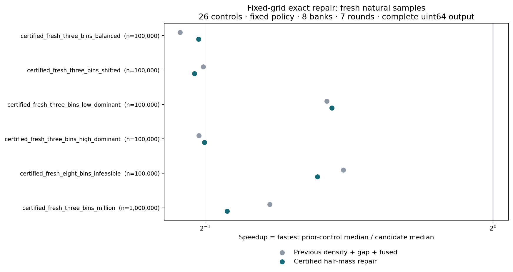

# BRC 残差排序：固定分组的半数样本可行性修复

日期：2026-11-10。Researcher-ID：`EM-DIRECT-10677F / TASK_RESEARCH`；Research-Activity-ID：`RA-851F29EFE6B4190069FE0D3B`。

## 本轮回答了什么

本轮把第三轮发现的密度贪心缺口落实成一个可执行的精确修复器：在固定的学习网格上，只要存在满足计数预算、覆盖原样本至少一半的整组子集，
新的过程就能正确判断可行性。它保留原先成功的快速路径，必要时使用最佳单组、分数背包上界和质量索引动态规划。
**精确性针对固定网格的样本可行性；真实覆盖量和完整排序耗时分别验证。**

6个新随机输入族的正式结果：相对同场最快的26个旧候选，本轮固定候选胜出 **0/6** 个中位数，
其中 **0** 个达到至少1.10倍，**6** 个至少慢10%，
对照/新版的几何平均为 **0.551**。
相对同场第三轮组合版，胜出 **3/6**，几何平均为 **0.981**。
旧条件、随机新条件和特制机制分别列示。

本轮的速度结果是否定性的：6个新条件全部至少慢于最快旧对照10%，没有一个相对第三轮组合版达到1.10倍。
因此这些结果不支持把“精确样本选择”作为默认提速方案。它完成了选择能力的修复，尚未改善整条处理路径。
百万三组条件中，8个根节点都接受DP方案，但8个残差子节点都触发真实半数回退；
子层平均额外扫描357085.625个值，而根DP平均只循环1146.5个质量状态。没有对各阶段单独计时，不能把总耗时差直接归因于DP本身。
平衡三组的残差子层甚至覆盖全部1024个建模样本、平均只分配12683.375个槽，实际扫描仍全部失败。
这把下一项可检验问题定位到模型对未参与建模位置的覆盖，以及失败扫描之前的停止成本。

前轮来源：[第三轮固定提交](https://github.com/awdawmip/enterprise-math/tree/6b096de75513160a579032ea11bc6cf8abd06008/experiments/brc_residual_sort_selection_20261110_b0e94005)。
本轮没有修改其源码；所有26个旧实现与唯一新候选`certified_combined_1024`在同一二进制中比较。
输出仍是保留全部重复次数的升序`uint64_t`数组；附带记录的稳定次序不在当前接口内。

## 1. 从贪心不足到完整的可行性判断

每个分组j有计数宽度w_j和样本观测数s_j。给定预算C与原始样本量S，要判断是否有一个整组集合K满足：

`sum(w_j,j∈K) <= C`，且`sum(s_j,j∈K) >= ceil(S/2)`。

原始连续区间、完整网格及密度贪心一旦成功，就沿用第三轮路径。只有密度提议未过样本门槛时，进入新过程：

1. 去除单独就超过预算的组；检查剩下的最高质量单组，过半即接受。
2. 按精确样本质量/宽度次序计算分数背包上界U。若`floor(U)<ceil(S/2)`，证明该固定网格不存在所需整组子集。
3. 其余情况运行精确DP，找到预算内最大可达样本质量m，m过半才接受。
4. 固定网格不可行时，沿用原最多三次多数侧间隙修复；选中首个可行模型后仍只做一次真实扫描。

分数上界在完整装入的前缀质量P之后，用剩余容量r及下一组的质量s、宽度w计算`floor(U)=P+floor(r*s/w)`。
用整数交叉乘法与128位中间值，避免浮点舍入影响拒绝判断。

动态规划定义`D_i[m]`为前i组实现精确质量m所需的最少宽度：

`D_i[m] = min(D_(i-1)[m], D_(i-1)[m-s_i]+w_i)`。

超过C的宽度用C+1表示。质量倒序更新，防止一个组被重复使用；每个组保留独立的选择位行，按历史行反向重建。
只有DP分支保证最大样本质量；提前接受的贪心或单组结果只是可行见证。
全部证明、相等成本处理、算术与重建细节见[THEORY.md](THEORY.md)。

S最多1024、非空组数B不超过S，DP时间为`O(B*S)`，宽度行空间为`O(S)`，重建另需`O(B*S)`位。
最大矩阵按64位字逐行对齐时为136KiB，另加至多4100字节宽度行及索引等空间。这是理论容量界，不是实测RSS。
完整排序继续要求实际残差不超过输入一半；失败扫描处理的是未损坏的完整原数组。

## 2. 可由现有学习代码生成的具体见证

十万个数、1024个样本、预算50000：

| 组 | 原始跨度 | 填充后计数宽度 | 样本质量 |
|---|---:|---:|---:|
| A | 29711 | 30000 | 410 |
| B | 24680 | 25000 | 307 |
| C | 24680 | 25000 | 307 |

三组放在对齐粗格的0、256、512位置，位移16。密度贪心选A后剩20000个槽，不能再装B或C，只有410个样本。
最佳单组仍是410；分数上界取整为655，无法拒绝。DP准确选B+C，用50000个槽保留614个样本。

实际数据按A/B/C各40000/30000/30000个值连续循环填充，再覆盖1024个实际采样位置。
选B+C后，真实残差至多41024，因此实际减半检查通过。前轮间隙路径则缩到三个端点小区间，
只有43个槽，实际覆盖至多1078，必然在第50001个残差处拒绝。
这是专门区分两种模型选择能力的构造，未混入新随机输入统计。

另一个机制保持相同样本，把未采样位置都改为A值。样本证书仍成立，实际扫描却拒绝，说明样本最优不能代替真实覆盖检查。
最佳单组与分数上界拒绝也各有单独机制。

## 3. 冻结和测量口径

代码、生成器、分析器和优化二进制于 **2026-11-10T09:41:06.516851+00:00** 冻结，早于任何第四轮性能或新输入生成。
冻结后未调参。一次完整运行按10个精确旧条件、6个新随机输入族、4个特制机制的顺序进行；没有另重复整套校准计时。

6个新族分别为三组40%/30%/30%的对齐布局、同样比例但各起点偏移2048、20%/40%/40%、44%/28%/28%、
八组中第一宽组45%其余七组分摊55%，以及百万规模的40%/30%/30%。前三组原始宽度为29711/24680/24680；
百万条件把宽度乘10、粗格位移改为20。八组宽度为40000及七个11000。
每组实际个数固定，值在组内随机产生，再随机打乱；采样位置没有人为写入端点。种子标签701—706及公式固定在源码中。

每条件8个输入库、7轮随机算法次序，名义每轮12毫秒，以完整输入库循环取整。计时包括输入复制、学习、全部选择计算、分配、扫描、递归、完整输出与析构。
诊断另跑。CPU0串行计时，团队没有同时运行编译或其他基准。当前环境为AMD EPYC 9V74 80-Core Processor、g++ (Debian 14.2.0-19) 14.2.0，C++20/O3/native。

每个条件的最快旧对照是同场26个旧候选的最小中位数，属于回顾性参考，不是可直接部署的选择器。
经验分位数和10%幅度只作描述；没有跨进程或多硬件显著性结论。几何平均等权计算条件，不代表实际负载分布。

| 分组 | 条件数 | 胜最快旧对照 | 至少1.10倍 | 至少慢10% | 对照/本版几何平均 | 前版/本版几何平均 |
|---|---:|---:|---:|---:|---:|---:|
| calibration | 10 | 0 | 0 | 4 | 0.898 | 0.977 |
| heldout | 6 | 0 | 0 | 6 | 0.551 | 0.981 |
| mechanism | 4 | 0 | 0 | 3 | 0.580 | 0.967 |

## 4. 六个新随机输入族

单位：微秒；速度比为对照耗时/本版耗时，大于1表示本版更快。

| 条件 | n | 第三轮组合 µs | 本轮精确修复 µs | 前版/本版 | 最快旧对照 | 对照 µs | 对照/本版 |
|---|---:|---:|---:|---:|---|---:|---:|
| certified_fresh_three_bins_balanced | 100,000 | 1535.793 | 1468.052 | 1.046× | offset_radix | 722.863 | 0.492× |
| certified_fresh_three_bins_shifted | 100,000 | 1466.617 | 1497.673 | 0.979× | sampled_shift_1024 | 730.233 | 0.488× |
| certified_fresh_three_bins_low_dominant | 100,000 | 1080.851 | 1067.713 | 1.012× | offset_radix | 724.459 | 0.679× |
| certified_fresh_three_bins_high_dominant | 100,000 | 1451.234 | 1431.950 | 1.013× | sampled_shift_1024 | 715.100 | 0.499× |
| certified_fresh_eight_bins_infeasible | 100,000 | 1020.959 | 1086.307 | 0.940× | offset_radix | 712.120 | 0.656× |
| certified_fresh_three_bins_million | 1,000,000 | 13211.992 | 14642.752 | 0.902× | sampled_shift_4096 | 7722.246 | 0.527× |



## 5. 四个机制与具体选择工作

| 条件 | n | 第三轮组合 µs | 本轮精确修复 µs | 前版/本版 | 最快旧对照 | 对照 µs | 对照/本版 |
|---|---:|---:|---:|---:|---|---:|---:|
| witness_exact_mass_dp | 100,000 | 704.591 | 784.365 | 0.898× | offset_radix | 603.660 | 0.770× |
| witness_exact_mass_hidden_majority | 100,000 | 694.404 | 720.089 | 0.964× | pdqsort | 117.911 | 0.164× |
| witness_best_singleton | 100,000 | 349.518 | 343.887 | 1.016× | sampled_shift_4096 | 341.078 | 0.992× |
| witness_fractional_mass_reject | 100,000 | 681.289 | 686.400 | 0.993× | robust_trim_1024 | 620.809 | 0.904× |

下表是8个输入库的每次排序诊断平均，包括递归层的选择尝试；根残差遇到提前拒绝时只表示扫描前缀。

| 条件 | 最佳单组成功 | 分数上界拒绝 | DP尝试 | DP成功 | DP拒绝 | DP状态循环次数 | 根实际残差 |
|---|---:|---:|---:|---:|---:|---:|---:|
| certified_fresh_three_bins_balanced | 0.000 | 0.000 | 0.875 | 0.875 | 0.000 | 1,008.875 | 40,000.875 |
| certified_fresh_three_bins_shifted | 0.000 | 0.750 | 1.875 | 0.250 | 1.625 | 1,452.000 | 42,344.125 |
| certified_fresh_three_bins_low_dominant | 0.000 | 0.000 | 0.000 | 0.000 | 0.000 | 0.000 | 20,000.000 |
| certified_fresh_three_bins_high_dominant | 0.000 | 0.000 | 1.000 | 1.000 | 0.000 | 1,205.375 | 44,000.000 |
| certified_fresh_eight_bins_infeasible | 0.000 | 1.750 | 3.375 | 0.000 | 3.375 | 8,754.125 | 18,210.125 |
| certified_fresh_three_bins_million | 0.000 | 0.125 | 1.000 | 1.000 | 0.000 | 1,146.500 | 400,205.000 |
| witness_exact_mass_dp | 0.000 | 0.000 | 1.000 | 1.000 | 0.000 | 1,130.000 | 40,000.000 |
| witness_exact_mass_hidden_majority | 0.000 | 0.000 | 1.000 | 1.000 | 0.000 | 1,130.000 | 50,001.000 |
| witness_best_singleton | 1.000 | 0.000 | 0.000 | 0.000 | 0.000 | 0.000 | 2,004.000 |
| witness_fractional_mass_reject | 0.000 | 1.000 | 0.000 | 0.000 | 0.000 | 0.000 | 50,001.000 |

全部20条件的诊断轨迹共有81次DP尝试，41次通过样本门槛、40次精确拒绝。
这些是独立诊断调用的次数，不能当作计时循环内DP总次数。最大单次修复工作向量容量为12,364字节，
包含排序索引、DP行、重建位和选中掩码，不包含整个排序的所有存储，也不是进程RSS。

每次修复的原始非空组几何、样本质量、预算、精确分数上界和独立重建的保留组编号都在[修复轨迹](results_all.csv.certified_attempts.csv)。
被修复的旧贪心提议仍标记失败，新选择单独记录成功；[原选择轨迹](results_all.csv.selection_attempts.csv)保留这些区别。
真实扫描与子问题见[节点轨迹](results_all.csv.certified_nodes.csv)。

## 6. 已知输入完整复测

这些输入已在第三轮看过，不作为新评价。所有时间来自本轮同一个二进制。

| 条件 | n | 第三轮组合 µs | 本轮精确修复 µs | 前版/本版 | 最快旧对照 | 对照 µs | 对照/本版 |
|---|---:|---:|---:|---:|---|---:|---:|
| selection_fresh_popular_wide | 100,000 | 902.526 | 899.387 | 1.003× | robust_dense_1024 | 773.687 | 0.860× |
| selection_fresh_rare_wide | 100,000 | 855.361 | 772.026 | 1.108× | offset_radix | 714.619 | 0.926× |
| selection_fresh_tail_12pct_asymmetric | 1,000,000 | 3651.986 | 3791.577 | 0.963× | selection_combined_1024 | 3651.986 | 0.963× |
| selection_fresh_tail_15pct_high | 100,000 | 447.946 | 469.836 | 0.953× | selection_combined_1024 | 447.946 | 0.953× |
| selection_fresh_tail_15pct_low | 100,000 | 435.225 | 440.276 | 0.989× | selection_combined_1024 | 435.225 | 0.989× |
| selection_fresh_uniform_uint64 | 1,000,000 | 15284.393 | 14875.762 | 1.027× | sampled_recursive_1024 | 14338.578 | 0.964× |
| selection_fresh_narrow_offsets | 1,000,000 | 2270.025 | 2291.137 | 0.991× | sampled_shift_1024 | 2217.293 | 0.968× |
| selection_fresh_interior_contamination | 100,000 | 367.552 | 404.733 | 0.908× | flat_frequency | 315.313 | 0.779× |
| selection_fresh_128clusters_12pct_tail | 250,000 | 975.220 | 1002.480 | 0.973× | frequency_sort | 892.070 | 0.890× |
| witness_density_mass_width | 100,000 | 585.131 | 672.972 | 0.869× | selection_fused_1024 | 492.913 | 0.732× |

## 7. 验证、复杂度与复现

O3与ASan/UBSan各核验740个输入场景、1734次完整输出：736个场景走新版诊断与nullptr计时路径，共1472次；
另208次冻结对照输出、54次第三轮参考输出。总场景数包含4个仅用于旧对照的场景。
337个小规模固定组用例逐一枚举全部子集，检查最大质量、同质量最小宽度、拒绝证书和重建；另用完整历史行DP对照内核的压缩实现。
47个无成功修复的场景核对原选择决策，检查真实半数/半数加一、残差子层、最大值和强制深度回退；覆盖16条排序路径、4种修复结果。

正式运行另检查160个输入库、27个候选的两条输出路径，共8,640次完整数组比较；
得到540条性能行、2,761条节点轨迹、315条修复轨迹、
3,888条原选择提议。运行耗时293.870秒。
ASan关闭泄漏检查；最终编译唯一警告来自未调用的历史重命名main。证据：[O3](execution_optimized_verify_v1.json)、
[ASan/UBSan](execution_sanitized_verify.json)、[正式运行](execution_all_frozen.json)、[冻结清单](frozen_manifest.json)、[作者侧审阅](REVIEW.md)。

固定64位字长和固定样本、网格、深度限制下，这一修复仍保持先前的O(n)时间及O(n)辅助空间类别；它完成的是一个有限的选择子问题。
这不构成新的通用整数排序复杂度突破，不是无限精度自然数的线性位复杂度结论。样本上最优、真实覆盖更大和运行更快是三个不同结论。

下载[brc_sort_reproducibility.zip](brc_sort_reproducibility.zip)，包含四轮源码、依赖、许可证、实际结果和证明，不含预编译程序或凭据。

```bash
cd brc_residual_sort_certified_20261110_b0e94005
python run_experiment.py --verify-only --cpu 0
python run_experiment.py --sanitize --verify-only --cpu 1
python run_experiment.py --skip-build --skip-verify --cpu 0 --subset all --output results_local.csv --receipt execution_local.json
python analyze_results.py results_local.csv --prefix local
```

选择本机允许的CPU编号。构建需要Linux taskset、GCC/C++20与Python标准库，绘图另需NumPy/Matplotlib。
这些是实际执行、手工证明和作者侧协作审阅证据，不代表外部独立评审、形式证明助手认证、定理推广或新颖性认定。
