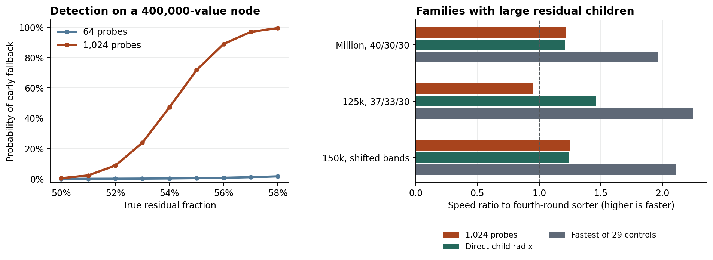

# BRC 残差排序第 5 至 7 轮实验

2026-11-11 · Researcher-ID `EM-DIRECT-BD65F5 / TASK_RESEARCH` · Research-Activity-ID `RA-F4CEEE2E70331B7B31160744`

这三轮检验一个端到端问题：根节点已经利用局部计数分走部分数值后，在残差子数组上，何时值得再学习一次？实验沿用升序 uint64 数组这一输出，逐个保留重复值。第四轮基线已经实现了固定网格的精确样本可行性修复，采用第四轮的学习器、输出与回退实现。此前的第三、四轮分别见 [6b096de](https://github.com/awdawmip/enterprise-math/commit/6b096de75513160a579032ea11bc6cf8abd06008) 和 [46352a6](https://github.com/awdawmip/enterprise-math/commit/46352a6399b785a169d997fbfedc5043c5fe6f7f)。

**在实际产生大残差子数组的三个新种子输入族，根节点保持第四轮，大子节点直接使用偏移基数排序，整次排序分别加速 1.209、1.464、1.239 倍。三个族共 24 组相同输入逐组更快。** 六个族等权，与第四轮的几何平均速度比为 1.147，与逐条件最快的 29 个既有对照为 0.739，六个条件的最快中位数均出自既有对照。单台共享云主机上观察到的局部节省主要出现在这三个实际触发子层分流的输入族。

## 第五轮：建表前验证真实覆盖

只在 n ≥ 16,384 且已有可用模型的节点启用预检。从未参与本节点建模的位置抽取 64 个互不重复的位置，检测冻结网格的真实成员关系。既有样本位置按原学习器重建并排除。候选位置用固定种子的伪随机数生成，最多尝试 256 次。设 s=1,024、t=floor(n/2)、N=n−s，64 个验证位置中有至少 ceil(64t/N)+13 个残差即提前回退。未触发时继续精确扫描，超过半数残差即退回完整输入的偏移基数排序。

比较了三条路径，分别为仅预检、预检触发后先检测全值域、以及子节点先检查全值域。最后一种只在大子节点执行，真实跨度 W=max−min+1 ≤ min(节点长度, 4,194,304) 即在已知端点内计数，否则继续原学习器。第六轮的“先查值域再用基数”则在超宽时立即用基数排序。

| 第五轮六个新条件，速度比为对照时间/候选时间 | 相对第四轮几何平均 | 相对第四轮胜出 | 相对最快27个旧对照几何平均 | 胜最快旧对照 |
|---|---:|---:|---:|---:|
| 64 点预检 | 0.991 | 1/6 | 0.631 | 0/6 |
| 64 点预检，提前拒绝时优先检查值域 | 1.000 | 3/6 | 0.637 | 0/6 |
| 大子节点先精确检查值域 | 1.098 | 5/6 | 0.699 | 0/6 |

历史百万三组的 8 份原数组上，根节点平均留下 400,205 个残差。子层再次学习后的真实残差率为 52.8%–58.5%，原模型在平均扫描 357,085.625 个元素后才发现超限。64 点抽查在 8 次中均继续扫描。第 5 轮新输入的 16 个自然失效节点也全部漏检。构造的“训练位置掩盖总体”条件则 8/8 次提前回退，耗时从 0.671 ms 变为 0.579 ms，最快对照 pdqsort 为 0.110 ms。自然失败和构造机制分别计数。

## 第六轮：提高预检分辨率，再与直接处理残差比较

根节点沿用第四轮。在深度至少 1、大小至少 16,384 的子问题，另测三种策略。第一种在模型选定后抽 1,024 个非训练位置，门限改为 ceil(1,024t/N)+42，最多作 4,096 次候选抽取。第二种直接进入既有偏移基数排序。第三种先查真实跨度，跨度在本节点预算内用计数，超预算就进入偏移基数排序。第三种在跨度过宽时会支付前置全范围检查，之后偏移基数实现仍按原路径读取端点。

| 六个输入族 | n | 第四轮 ms | 子层 1,024 点预检 ms | 子层直接基数 ms | 子层先查值域再计数或基数 ms | 同场最快既有对照 ms |
|---|---:|---:|---:|---:|---:|---:|
| 三组 40%/30%/30% | 1,000,000 | 15.912 | 13.086 | 13.160 | 13.928 | 8.089 |
| 三组 37%/33%/30% | 125,000 | 2.122 | 2.243 | 1.450 | 1.586 | 0.945 |
| 区间加宽并偏移，43%/26%/31% | 150,000 | 2.171 | 1.738 | 1.752 | 1.980 | 1.031 |
| 窄范围偏移 | 131,072 | 0.337 | 0.338 | 0.335 | 0.334 | 0.333 |
| 7% 高端远值 | 100,000 | 0.591 | 0.588 | 0.577 | 0.585 | 0.475 |
| 全 64 位均匀 | 100,000 | 1.498 | 1.509 | 1.484 | 1.502 | 1.256 |

三个会产生大子问题的输入族相对第四轮的耗时比分别为 1.209、1.464、1.239，几何平均 1.299。其余三个输入族没有触发这项子层分流，测量中的小幅波动不计作机制收益。对子层直接基数这一固定版本，六族相对第五轮的“子层先查值域，超宽继续学习”几何平均为 1.048。

在六轮同一批数组、同一模型的 33 个受检子节点中，15 个实际超限，18 个可以通过。64 点路径检出 0/15，1,024 点路径检出 13/15，两个版本对这 18 个可通过节点均为 0 次误拒。按失效来源，百万三组为 6/8，较宽偏移三组为 7/7。37%/33%/30% 组中两层共 16 个模型都能通过，直接子层基数在三种新方案中耗时最低，8 份输入全都比第四轮快，逐份输入的速度比为 1.413–1.599（按三位小数取整）。每个模型有足够计数覆盖，同时它的学习、建表、散写、再输出仍可能比一次整数基数排序更耗时。

## 抽多一些位置如何改变门限两侧的判断

固定输入与已选模型。设 F 为全数组的真实残差数量，e 为训练位置中在冻结模型下的真实残差数量。理想均匀抽样、取满 m 个验证位置时，命中残差数服从参数为 (n−s,F−e,m) 的超几何分布。按对应门限求上尾即提前回退概率。对一个 n=400,000、e=0 的子节点：

| 真实残差率 | 64 点提前回退概率 | 1,024 点提前回退概率 |
|---:|---:|---:|
| 50%，精确扫描可通过 | 0.0332% | 0.4128% |
| 53% | 0.1701% | 23.7717% |
| 55% | 0.4502% | 71.7714% |
| 56% | 0.7080% | 88.9427% |
| 58% | 1.6403% | 99.4224% |

上述参数同时改变了抽查量与拒绝门限。固定输入测试测的是实际伪随机实现。在独立的十万个值机制实验中，对每个残差比例重放 4,096 个固定种子，使用 64 点预检，50%、60%、70%、80% 真实残差分别触发 2、171、1,942、3,989 次；刚刚超出一个位置的 50,001 个残差仍只触发 2 次。详见 [第五轮推导](theory3/PREFLIGHT_MATH.md)、[第六轮推导](theory3/CHILD_GATE.md)、[重放数据](phase5/probe_sweep.csv)。超几何分布定义亦可核对 [R 的统计手册](https://stat.ethz.ch/R-manual/R-devel/library/stats/html/Hypergeometric.html)。

## 第七轮：有足够计数空间，分组计数是否更省时间

取三批百万三组输入，从第四轮根节点实际提取残差。对已排序的非空残差支撑集，所有值的整数包络宽度减去最大的 k−1 个内部空隙，等于至多 k 个不交区间覆盖全部值所需的最少槽数。这给出了与实现无关的最优参照。任何区间切分至多去掉 k−1 个空隙，且在选择的空隙处分开即可达到该值。

在 24 份实际残差数组中，单段满足预算 20 次；最优两段满足预算 24 次，需 297,097–298,435 个槽。单段失败的 4 份都含主簇的 400,000 个数，另有 97、1,543、466 或 785 个远端值。例如其中一份的区间宽度被 97 个远端值撑到 268,435,537；分两段后只需 297,188 个槽。直接复用父网格的高位分组，对每组记录真实的最小值和最大值，24 份均可装入各自预算，逐值重建也全部正确。逐组数据和证明见[结构诊断](gaps/README.md)。

将这项诊断落实为完整的排序路径。父模型给出网格原点、位移和窗口，子层第一次扫描记录各非空组真实端点。全部组在窗口内且宽度之和不超过 min(子节点长度, 4,194,304) 时，按精确计数输出；遇到窗口外值或槽数超预算就对完整子数组做偏移基数排序。使用相同六族、此前未用于计时的输入编号 64–71，与 32 个冻结对照同场复测。

| 实际触发的输入族 | 新版成功计数 | 父网格分组计数 ms | 子层直接基数 ms | 第四轮 ms | 同场最快旧对照 ms |
|---|---:|---:|---:|---:|---:|
| 百万三组 | 7/8 | 14.872 | 13.132 | 15.325 | 7.847 |
| 125,000，37%/33%/30% | 8/8 | 1.718 | 1.417 | 2.090 | 0.888 |
| 150,000，较宽偏移三组 | 8/8 | 2.181 | 1.808 | 2.144 | 1.079 |

对这 24 份相同输入，父网格版本有 23 份能用精确表排序，全部 24 份中，只有 1 份的端到端耗时小于子层直接基数。新百万输入编号 67 的根残差有 378,861 个数，父网格方法读到第一个残差就发现其前缀超出已建模窗口，转入基数排序。这与前述对 24 份诊断数组观察到的两段完全覆盖相容：前者是不同种子，计时实现还限定父网格窗口。六族计，父网格相对直接子层基数的耗时比（直接基数时间/父网格时间）的几何平均是 0.914，相对逐条件最快的 32 个旧对照是 0.663，胜出 0/6。它比第四轮的对应几何平均是 1.024。

相同的根模型下，三组族的直接子层基数收益在另一批输入中再次出现。第七轮这三个族分别加速 1.167、1.474、1.185 倍，24/24 份输入仍比第四轮快。与第六轮合计，同样三个族、两批不同种子共 48/48 份输入的中位耗时较短。本轮录得的 23 次计数成功说明残差确实保留了父层的分组结构。计时中的分组路径另读残差端点并初始化和展开局部计数表，逐阶段的独立耗时未测量。后续需要优先判别根节点的局部计数是否值得启动，并把已有快速版本和整数组偏移基数一并作为可直接调用的对照。

## 验证范围和使用数据的方法

- 第五轮 30 种实现、8 个条件、每条件 8 份输入，各测 5 轮，共 9,600 次计时输出检查与 256 次独立诊断输出检查。
- 第六轮 32 种实现、6 个同家族新种子条件、每条件 8 份输入，各测 5 轮，共 7,680 次计时输出检查与 240 次独立诊断输出检查。第五轮已知百万输入沿用上轮原数组，第六轮每个家族改为此前未用于计时的输入编号 32–39。
- 第七轮 33 种实现、6 个条件、每条件 8 份输入，各测 5 轮，共 7,920 次计时输出检查、288 次独立诊断输出检查。三轮共 25,200 次计时排序检查、784 次诊断排序检查。
- 三轮统一用 AMD EPYC 9V74、g++ 14.2、C++20、-O3 -march=native，固定 CPU 0 单进程串行计时。各份输入和各算法的顺序均打乱。每次测量包含复制、完整排序、临时容器析构，逐元素校验在独立计时区段。诊断额外遍历真实模型的残差，用来识别误拒与漏检，不进入计时。
- 优化构建及 ASan/UBSan 构建各完成第五轮 1,360 次、第六轮 1,056 次、第七轮 154 次定向输出检查。第五轮另核对 1,202,434 个原学习器位置，第六轮用独立集合实现重放了 256 次预检；第七轮另运行 265 个独立分组跨度和回退检查。沙箱中的 LeakSanitizer 退出检查失败后，以关闭泄漏检查的方式重新运行，ASan/UBSan 检查通过。测试覆盖 64 位边界、重复值、叶子阈值、预检规模阈值与实际回退。
- 性能单位表格为毫秒，先取同一输入五次的中位数，再取八份输入的中位数。强对照按条件事后选中。程序处理完整 uint64 多重集，原有 n≤256 的叶子仍用标准排序。实验评价分布条件、识别能力及处理成本，没有改变固定字长整数排序的渐近界。

[第五轮全部同场结果](phase5/results/all_methods.csv) · [第六轮全部同场结果](phase6/results/all_methods.csv) · [第七轮全部同场结果](phase7/results/all_methods.csv) · [同输入配对比较](phase6/results/bank_pairs.csv) · [实际检出与漏检](phase6/results/prediction_matrix.csv) · [复现步骤](REPRODUCE.md)
